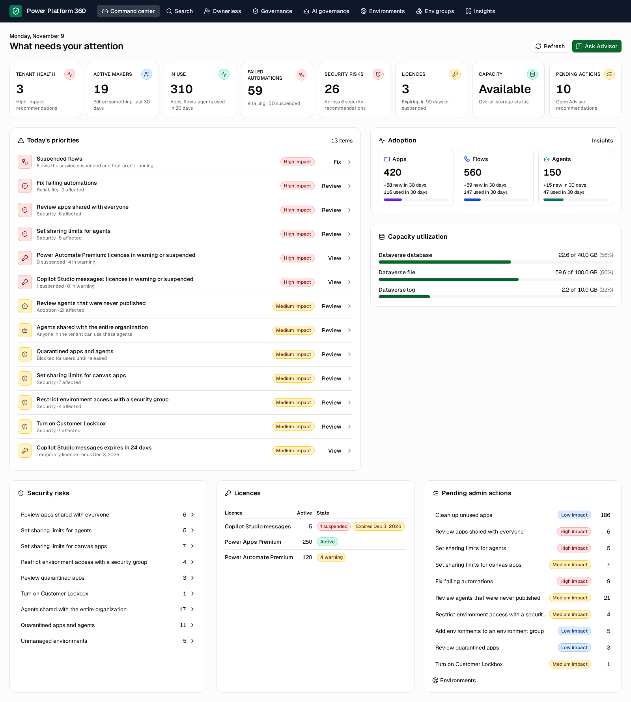

# Power Platform 360

**One admin portal for your whole Power Platform tenant, built with Copilot Cowork App Builder and running on the Copilot managed runtime.**

Power Platform 360 brings inventory, governance, AI and agent oversight, environment management and usage insights into a single app that runs on **live tenant data**. You don't install a solution or import a package. You rebuild the app in your own tenant from one prompt and a set of reference screenshots. This folder contains everything you need to do that.



> The screenshots in this kit use sample **Contoso** data. When you rebuild the app, it shows your own tenant's data.

---

## Contents

| Asset | What it is |
|---|---|
| [`build-prompt.md`](build-prompt.md) | The full build prompt. It covers connectors, look and feel, every page, panel and action, data-layer facts and the quality bar. |
| [`screenshots/`](screenshots) | 25 reference screenshots of the original app. Attach them with the prompt so App Builder matches the layout, density, colours and components. |
| [`Power-Platform-360-rebuild-kit.zip`](Power-Platform-360-rebuild-kit.zip) | The prompt and all screenshots in one download. |

---

## What the app does

| Page | Route | What an admin can do | Screenshots |
|---|---|---|---|
| **Command center** | `/` | See what needs attention today: tenant health, active makers, failed automations, security risks, licences, capacity and a prioritised action list. Every row drills down. | 01, 22a |
| **Search** | `/search` | Search across apps, flows, agents, environments, connectors and people by name, GUID, owner, environment or `connector:<name>`. Open any item for its ownership, usage, dependencies, sharing and licensing, and act on it. | 02, 03 |
| **Ownerless** | `/ownerless` | Find apps, flows and agents whose owner was deleted or disabled. Score their risk, then reassign, quarantine or email about them in bulk. | 11, 22b |
| **Governance** | `/governance` | See the policies that apply at the tenant, environment group, environment or security group level. Edit rules, check their impact before you save, and run what-if simulations such as blocking a connector. | 04, 05 |
| **AI governance** | `/ai` | Inventory agents and AI apps by experience: Copilot Studio, Agent Builder, agent flows, App Builder, managed, vibe and code apps. See builders, models, knowledge, channels and Copilot credit allocation. | 06–10 |
| **Environments** | `/environments` | View the managed percentage and environment mix, turn on Managed Environments, act on Advisor recommendations and chat with **Ask Advisor**. | 12, 13, 23 |
| **Env groups** | `/groups` | Create and manage environment groups, their sharing limits and their rule-based policy rules, using templates. | 14, 15 |
| **Insights** | `/insights` | Use executive dashboards for apps, flows, agents and usage. Every chart drills into a filterable sheet, and each tab switches between Dashboard and Grid. | 16–21 |
| **Email makers** | everywhere | Send branded, per-maker HTML emails next to every export. Each maker receives only their own items. | 22b, 24 |

---

## Prerequisites

### People and access

| Requirement | Why |
|---|---|
| **Power Platform administrator** (or Global administrator) role | The app uses the Power Platform admin connectors, which read tenant-wide inventory and policies and perform admin actions. |
| **Microsoft 365 Copilot with Copilot Cowork** and the **App Builder** (`/app`) experience | App Builder generates the app from the prompt and publishes it as a managed app on the Copilot managed runtime. |
| **A licensed Exchange Online mailbox** for the person building the app | The "Email makers" feature sends mail through Office 365 Outlook. |
| **Copilot credits** available to the builder | Building the app in Cowork uses Copilot credits. How many depends on how many iterations you run. |

### Connections (App Builder asks you to approve each one)

| Connector | Used for |
|---|---|
| Power Platform for Admins V2 (`shared_powerplatformadminv2`) | Environments, the tenant-wide inventory API, Advisor and Ask Advisor, environment groups, rule-based policies, capacity, Copilot credits, agent actions and flow run history |
| Power Apps for Admins (`shared_powerappsforadmins`) | App quarantine, reassigning owners, deleting apps and listing who an app is shared with |
| Power Automate for Admins (`shared_microsoftflowforadmins`) | Turning flows on and off, adding co-owners, deleting flows and reading permissions |
| Office 365 Users (`shared_office365users`) | Resolving owner and maker IDs to name, department, email and account state, plus the people picker |
| Office 365 Outlook (`shared_office365`) | Sending branded emails to makers |

These connectors must be allowed by the data policies in the environment where App Builder creates the app.

### Recommended

- **Start in a demo or test tenant.** The app can quarantine, reassign and delete resources, change policies and send email. Every destructive action has a confirmation step, but try it somewhere safe first.
- **Use a desktop browser at 1440 px or wider** for the full layout.

---

## Rebuild it step by step

### 1. Get the kit

The easiest way is to download [`Power-Platform-360-rebuild-kit.zip`](Power-Platform-360-rebuild-kit.zip) (choose **Download raw file**) and unzip it. You can also clone the repo:

```bash
git clone https://github.com/microsoft/power-cat-skills.git
cd "power-cat-skills/Power Platform 360"
```

### 2. Start a new Cowork conversation

Open **Microsoft 365 Copilot → Cowork** and start a **new** conversation, signed in as your Power Platform admin account.

### 3. Attach the screenshots

Attach all 25 images from `screenshots/`. They are your visual spec. The prompt refers to them by number, for example "screenshots 06–10".

### 4. Paste the build prompt

Open [`build-prompt.md`](build-prompt.md), copy **all** of it and paste it as your message. It starts with `/app`, which routes the request to App Builder. Send it.

> Paste the whole prompt in one message. Section 5 ("Data layer: important facts") saves App Builder from rediscovering the inventory API's quirks and avoids most of the rework.

### 5. Approve the connections

App Builder asks you to create or approve a connection for each of the five connectors. Sign in with your Power Platform admin account for each one. The prompt tells App Builder to:

- verify one live read per connector before it reports that data works
- avoid sample data unless a connection is genuinely unavailable

### 6. Let it build every page

The prompt asks App Builder to build every page, panel and action in one go. If it stops early, reply with:

```text
Continue: build the remaining pages and features from section 3 of the prompt, then re-run the quality bar in section 6.
```

### 7. Check quality, then publish

App Builder runs the typecheck and lint until they're clean, then publishes the app and gives you its link. Managed apps open at `https://play.managedapps.cloud.microsoft/apps/{id}`.

### 8. Verify in your tenant

Work through this checklist before you share the app:

- [ ] **Command center:** all 8 KPI tiles show live numbers, and "Today's priorities" lists Advisor recommendations.
- [ ] **Search:** searching for an app you know returns it, and the detail sheet shows the owner's name, not a GUID.
- [ ] **Ownerless:** items from departed owners appear, and system accounts (`00000000-0000-0000-0000-…`) are excluded.
- [ ] **Governance:** policy cards show connector display names and a "via" line, and the what-if simulator returns affected resources.
- [ ] **AI governance:** agents appear with their experience, model and channels, and the Copilot credits tab shows the purchased, allocated and consumed totals.
- [ ] **Environments:** the managed % ring renders, and Ask Advisor returns a formatted answer.
- [ ] **Insights:** clicking any chart slice opens a drill sheet with a filter breadcrumb.
- [ ] **Email makers:** a test email sent to yourself renders correctly in Outlook (see screenshot 24).

### 9. Share with your admin team

Share the published app with other Power Platform admins. Each user's actions run under their own connections and permissions.

---

## Known limits (shown in the app, not faked)

| Area | Behaviour |
|---|---|
| Advisor actions | `ExecuteRecommendationAction` action names aren't published, so the app links to guidance instead of executing actions. |
| Tenant users | `GetTenantUsers` is deprecated, so the app uses **active makers** (distinct editors in the last 30 days). |
| DLP | Data policies are shown through the **ConnectorManagement** allow-list rule. |
| Security groups | The API doesn't return group names, so the app shows group IDs and says so. |
| AI feature toggles | Tenant-wide AI feature toggles aren't in the API. |
| Copilot credits | Consumption data can lag. |
| Managed Environments | Turning Managed Environments on applies directly. A `409 OperationNotStartable` means another change is still running, and the app shows a friendly retry message. |

---

## Troubleshooting

| Symptom | Fix |
|---|---|
| A page shows sample data | A connection wasn't approved or failed its live read. Ask App Builder to re-check that connector and re-bind it. |
| Owners show as GUIDs | The Office 365 Users connection is missing or lacks directory read access. |
| A drill-down list crashes on "Load more" | Ask App Builder to use `useQuery` with an explicit page-token list instead of `useInfiniteQuery`, as section 3.8 of the prompt says. |
| Flows appear twice | Solution-imported flows share an ID across environments. Row keys must include the environment ID (see section 5 of the prompt). |
| An inventory query errors | Confirm that the API version is `2024-10-01`, values are single-quoted KQL literals, and no column is named `kind`. |
| A policy save fails | `PatchRuleBasedPolicy` must send **all** rule sets, with only the edited one changed. |

---

## Customise it

The prompt is a starting point. Once the app is built, keep the Cowork conversation open and refine it in plain language. For example:

- "Add a Dataverse capacity trend chart to the command center."
- "Change the theme to our brand colours: primary #0F6CBD."
- "Add a Solutions page listing unmanaged solutions per environment."

---

## Feedback

Open an issue in this repository. Use the `report-issue` shared skill, or file one directly on GitHub.

Maintained by Microsoft **Power CAT** (Customer Advisory Team).
